<div align="center">


# Booked In

**A booking page for solo beauty professionals.**

Her clients book themselves, from a link in her Instagram bio.
No commission, no marketplace, and nobody else advertised on her page.

Made by YSB Designs.


</div>

<br/>

> [!NOTE]
> **Reading this without a technical background?** Start at *The problem*, *Two
> screens, one diary* and *Free and Pro*. Those three explain what Booked In is
> and what it does for someone running a beauty business on her own. Everything
> from *How the pieces fit* onwards is for whoever maintains the code.

### How to read the diagrams

Every picture in this file uses the same four colours, and they always mean the
same thing. The connectors animate, so you can see which way the information
actually travels.

| | Means |
| :--- | :--- |
| 🟪 **Plum, carmine border** | Booked In itself: our code |
| 🟩 **Pale mint** | Built, tested and working today |
| 🟨 **Sand, dashed border** | Written down, not built, not sold as built |
| ⬜ **Blush** | A person, or something outside the product |

---

## The problem, in one picture

A lash technician's diary lives in her Instagram DMs. A client asks at eleven at
night whether Saturday is free; she has to open her calendar, count back the
three weeks since the last infill, and remember she is in Coventry that day. By
the time she answers, the client has gone quiet and the slot is still empty.



Plenty of products book appointments. What Booked In does differently is that
**the page is hers**: her photographs, her prices, her link, and no marketplace
showing her client three other technicians nearby.

> [!TIP]
> **The booking page is the acquisition channel.** Every client page carries
> "Powered by Booked In" in its footer, on every plan, and every page is seen by
> fifty to two hundred women, some of whom are beauty technicians themselves.
> That line used to come off at Pro, which meant the studios with the most
> clients were the ones nobody could trace back here. It stays now.
>
> What Pro removes instead is the mark on her **story cards**, which go out
> under her name on her own Instagram. A page we host for her and a post she
> makes herself are not the same thing, and only one of them is ours to sign.

---

## Two screens, one diary



She never has to be the bottleneck. Bookings arrive while she is working on
somebody else, and anything she changes — a price, an hour, a photograph, a day
off — is live on her page the moment she saves it.

---

## Nothing can double-book

This is the part worth reading the code for.

The page this grew out of could not lock a slot. Two people on two devices could
both take 09:00 and both get a confirmation — proven with a two-browser test,
not assumed.



Checking "is it free?" in application code does not fix that. It only narrows
the window between the check and the insert. So the refusal lives in the
database (`platform/001_schema.sql`):

```sql
alter table booking add constraint booking_no_overlap
  exclude using gist (
    tenant_id with =,
    tstzrange(starts_at, ends_at, '[)') with &&
  ) where (status = 'confirmed');
```

A range overlap rather than an equality test, because a 90-minute full set
booked at 09:00 has to block 10:00 as well. Two concurrent transactions cannot
both satisfy it: the second to commit raises `23P01` and rolls back.

> [!IMPORTANT]
> **Fifty simultaneous attempts on one slot produce exactly one booking** and
> forty-nine refusals. `platform/test_booking.sh` runs that against a real
> Postgres on demand, so it is a claim you can check rather than one you have to
> take on trust.

The same transaction boundary is why a losing booking never emails anybody: the
mail trigger fires `AFTER INSERT`, so a row the constraint rolls back takes its
queued confirmation with it. Thirty racing bookings produce one booking and
exactly two emails.

---

## How the pieces fit



Three static pages, no framework and no build step — every page is a file you
can open. All the logic that matters is in the database, where it can be tested
and where row level security can keep one studio's client list away from every
other studio.

> [!CAUTION]
> **Postgres grants `EXECUTE` on a new function to `PUBLIC` by default.** Three
> `SECURITY DEFINER` functions were therefore callable by anonymous visitors
> until `009_lockdown.sql`: `next_mail()` hands back the outbox, which holds
> client names and email addresses; `setting()` returned any row of
> `platform_setting`, where `006` was storing a service-role key; and
> `set_plan()` would have let anybody put any studio on Pro. If you add a
> function, add its grant to `009` and revoke the rest.

---

## Free and Pro



Pro now carries the thing that pays for it. **Rebooking** watches how long it
has been since each client's last appointment, against an interval set per
treatment, and sends one email when she is about due with a link straight to a
free time. Nothing about it is clever; it is simply the message a studio means
to send and never does. A single client coming back one extra time in a year
covers the subscription several times over.

It is deliberately hard to misuse. It is off until she turns it on, even though
the intervals arrive filled in. It sends once per visit, enforced by a primary
key rather than by being careful. It skips anyone with an appointment already
booked, anyone whose last visit was over three months ago, and anyone who has
opted out — and every message carries the link that opts her out, for good, in
one tap. That is the soft opt-in the law describes; miss any part of it and this
would be marketing, which it is not.

## The one thing that is not a convenience

Tinting and lash extensions need a patch test 24 to 48 hours beforehand. The
exact window is the insurer's and they differ; a signed disclaimer does not
replace it, and a test done at another salon does not count. If a client reacts
and the studio cannot produce a dated record, the insurance that was supposed to
cover it may not — and a reaction claim is the kind that ends a one-person
business.

**Every booking platform treats this as her problem.** They sell appointments,
and the compliance that has to sit around the appointment is left in a notebook,
or in her head, or nowhere. Which means the one thing a stranger can do on her
page — book herself in — is also the thing that can quietly void her cover, and
she finds out afterwards.

Here the database refuses. A treatment that needs a test cannot be booked by
somebody who has not had one in time; the refusal says what to do instead; the
booking page says so on the tile before anybody picks a time; and booking the
patch test appointment *is* the record, so nobody has to remember to write
anything down. The window, the lifetime and which treatments need one are all
hers — we are not going to guess her policy's wording for her.

It is turned on from the trade at signup, because a setting that arrives switched
off is a setting nobody finds.

---

## Two trades, one platform

This started as software for the ones who travel, and it showed: openings
carried an *area*, the copy talked about turning up, and nowhere in the database
held an address. That is half the trade. The other half works from a room at
home, a chair rented in a salon, or a shop — and for her clients the first
question is not when she is free, it is **where she is and where to park**.

So where the appointment happens is now something she says, once, and three
answers are allowed:

| | Her page | Her diary |
|---|---|---|
| **Clients come to me** | Shows the address, a maps link, and the line no address field holds — the buzzer, which door, the parking | — |
| **I travel to them** | Asks each client for her own address, and will not accept a town without a number or a postcode | Every appointment carries it, as a link straight to maps |
| **Both** | Her client chooses, in one tap, before the calendar | Only the ones she is travelling to |

The asymmetry is the point. A technician working from a room at home must
**never** be asked to publish that address "for her page", and a client driving
to a treatment must never be left guessing. Getting the two the wrong way round
is the kind of mistake that is only ever found by a client standing in the wrong
street, so the pages, the confirmation emails, the night-before reminder and the
calendar file all take their answer from the same setting — and the booking is
refused outright if an address is needed and missing.

An address a client gives once is remembered against her record, so a regular
never types it twice, and a move updates her without rewriting where last
month's appointment actually was.

---

## The card she posts


A link in a bio is passive: it works for somebody who has already decided to go
looking. What fills a quiet Thursday is a picture in a Story saying Thursday is
quiet. The **Share** tab draws one from her real diary in a tap — the times on
it are the ones actually long enough for the treatment she picked, so the card
can never advertise an appointment she cannot take.

Three of them: the spaces left this week, a gap that has just opened in the
next two days, and an evergreen card with her treatments and prices. Drawn on a
canvas in her own browser, which is partly because there is no server to draw
them on and partly because it means her diary never has to be sent anywhere to
become a picture of itself.

**It is her brand, not ours.** She gives one colour and the rest of the palette
is derived from it in HSL — the same hue taken pale for the fills and dark for
the type — because asking a lash technician for five hex values is asking her to
do a job she did not sign up for, and the result would clash anyway. That holds
for the black-and-gold and the sage-green that half this trade uses. She can add
a logo, which replaces her name at the top, and switch the card between light
and dark and between left and centred.

The preview sits inside Instagram's own frame — the progress bar, her handle,
the "Send message" strip — so the two bands that cover a Story are visible while
she is making the card rather than discovered after she has posted it.

Free cards carry a small Booked In mark; Pro cards do not. That is now the *only*
place Pro removes it: the booking page carries "Powered by Booked In" on every
plan. A page we host for her and a post she makes under her own name are
different things, and only one of them is ours to sign.

`test_story.js` checks by counting ink, because a canvas has no DOM to assert
against. It covers the things that are invisible until the card has been posted
and it is too late: nothing readable in the covered strips, a long studio name
shrinking rather than running off the edge, and a near-black brand colour still
producing a link pill you can read.

<br clear="right">

> [!WARNING]
> **Everything in green is built, tested and working. Nothing has been
> provisioned.** No email has ever actually been sent and no payment has ever
> actually been taken: every function that composes them is covered by tests and
> all three edge functions type-check under `--strict`, but neither has run
> against a live provider. That needs keys.
>
> **Deposits, a custom domain, rescheduling and publishing straight to
> Instagram are not built.** Do not describe them anywhere — including the
> marketing page — as features. The pricing card once did, and that is the sort
> of copy that gets a first customer refunded.
>
> `platform/INTEGRATIONS.md` sets out what Instagram publishing and deposits
> each actually need. Both are gated on somebody else's approval queue rather
> than on code, which is worth knowing before either is promised to anyone.

---

## This repository

| Path | |
| :--- | :--- |
| `site/` | the marketing page, the marks, the type, the legal pages, `brand.md` |
| `app/` | sign in, the three-step wizard, her dashboard |
| `book/` | her clients' booking page and their manage page |
| `platform/` | fourteen migrations, three edge functions, seventeen test suites |
| `vendor/` | supabase-js, served from here rather than a CDN |
| `scripts/` | the generators: diagrams, icons, share cards, type |
| `assets/diagrams/` | the pictures in this file, as source and as SVG |
| `index.html`, `demo/` | the original èllash page this grew out of |

Nothing on any page is fetched from anybody else. The typefaces, the Supabase
client and every image are served from this origin, so opening a booking page
tells Google, jsDelivr and the rest precisely nothing. That is partly a privacy
promise the notice has to be able to keep, and partly speed: a first visit to
the marketing page is five requests and 3 KB of render-blocking CSS.

### Running the tests

```bash
./build.sh             # the browser suites all read dist/, so build it first
cd platform
./test_booking.sh      # the overlap constraint, under real concurrency
./test_signup.sh       # signup, availability, row level security
./test_cancel.sh       # cancelling from both sides, closures
./test_email.sh        # what is queued, and what is not
./test_reminders.sh    # the Pro reminder
./test_billing.sh      # plan state, and that she cannot grant herself Pro
./test_abuse.sh        # the booking limits, the honeypot, the address hash
./test_clients.sh      # the client record, the backfill, one studio one list
./test_rebook.sh       # the nudge, and every rule that stops it being spam
./test_patch.sh        # the patch test, and that nobody can book around it
./test_venue.sh        # where she works: her address, or the client's
./test_proplus.sh      # three plans, and that paying more takes nothing away
./test_function.sh     # the three edge functions type-check
node test_app.js       # her dashboard, end to end
node test_book.js      # her clients' pages, end to end
node test_routing.js   # what each address serves, and where the slug comes from
node test_marketing.js # layout on eight screens, contrast on every text style
node test_story.js     # the Stories card, by counting ink on the canvas
node test_links.js     # every link, robots, the sitemap, what stays unindexed
node test_speed.js     # requests and bytes on a first visit, against a budget

node shots.js [dir]    # not a test: photographs every screen, for looking at
```

The SQL suites build a throwaway Postgres cluster each time. They need
`postgresql-16` and a non-root user, because Postgres refuses to run as root.

The browser suites serve `dist/` over HTTP through `platform/serve.js`, which
applies Render's own resolution order — a real file beats the catch-all
rewrite, exactly as in production. They used to open `file://` URLs, which
cannot see an absolute path or the rewrite at all: the bug that made
`/studio-mila` read its slug as `booked-in` was invisible to every one of them.

> [!NOTE]
> The front-end suites drive a **stubbed** Supabase client: they test this
> code's own logic and make no claim about supabase-js itself. Only Chromium is
> installed in the environment this was built in, so **real Safari has never
> been tested.**

### Turning it on

`platform/README.md` has the eight steps and explains what each migration is
for. The short version: create a Supabase project, apply `001` to `016`, set the
four environment variables on Render, deploy the three functions with their
keys.

`build.sh` refuses to produce a `dist/` that contains a service-role key. It
decodes every JWT it finds rather than grepping for the phrase, because the two
keys look alike and a comment that mentions one is not a leak.

> [!CAUTION]
> **This repository is public, and the service-role key bypasses every row level
> security policy in the database.** It belongs in a gitignored `*.local.sql`
> copy, or pasted straight into the Supabase SQL editor and never saved.
> `006_cron.sql` says so where you would be tempted to put it.

---

## The diagrams

Five SVGs, and the connectors animate. GitHub renders mermaid in a fenced block
but cannot animate it and cannot theme it, so these are built rather than
inlined. The sources stay in the repo as text, so a diagram is still something
you can edit and diff:

```bash
assets/diagrams/*.mmd             # the source, one file per diagram
node scripts/build-diagrams.mjs   # regenerates the SVGs
```

The build script holds the palette and the animation in one place. It declares
the colours light-first and redefines them under `prefers-color-scheme`, so the
diagrams follow GitHub's theme, and it keeps a `prefers-reduced-motion` guard so
anybody who has asked their machine for less movement gets a still picture.

> [!NOTE]
> **Do not add a `font-family` override to that stylesheet.** Mermaid sizes every
> box for the font it measured with *before* the stylesheet is added, so changing
> the face afterwards clips the last line of a label.

Rendering needs a Chromium and mermaid:

```bash
npm i -D playwright mermaid@11.4.1
node scripts/build-diagrams.mjs
```

---

## The èllash page

`index.html` and `demo/` are the original one-page booking flow built for
**èllash**, a mobile lash technician covering Birmingham, Nuneaton and Coventry.
It is still live, and Booked In grew out of it.

It carries her real prices, photographs and aftercare, and it cannot be reused
as a sales sample for anyone else — the photographs are her clients' faces.
`site/` exists because of that.

---

## Licence

All rights reserved, YSB Designs. Not open source.
